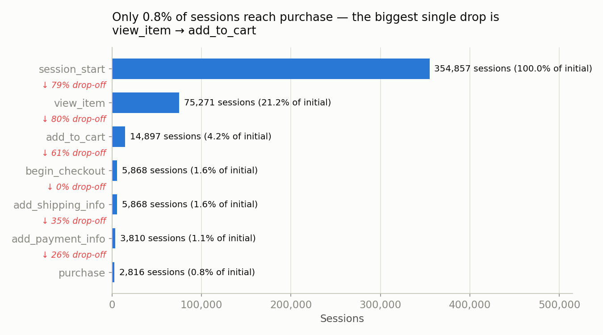

# E-commerce Funnel & Retention Analysis — Google Merchandise Store (GA4 sample)

A product-management-style analysis of a real (obfuscated) e-commerce event
stream: where users drop out of the purchase funnel, which segments and
product categories leak the most, whether users come back, and three A/B
tests — with real baseline rates and `statsmodels`-computed sample sizes — to
fix the biggest leak.

## Question

Of all the sessions that land on this store, how many reach purchase, where
exactly do they drop off, and what's the highest-leverage experiment to run
first?

## Dataset

Google's public **GA4 obfuscated sample e-commerce dataset** in BigQuery:
`bigquery-public-data.ga4_obfuscated_sample_ecommerce.events_*` — real
(obfuscated) event data from the Google Merchandise Store.

- **92 daily tables, 2020-11-01 to 2021-01-31**
- **4,295,584 events, 270,154 users, 360,129 sessions, 4,452 purchases**

Full profiling, event-name breakdown, and every obfuscation quirk this
project had to handle (`<Other>`, `(data deleted)`, inconsistent `item_id`
across event types, etc.) are in [`docs/data-profile.md`](docs/data-profile.md).

## Approach

1. **SQL** (`sql/01`–`06`, BigQuery Standard SQL) — daily KPIs, a session-level
   7-step funnel, the same funnel by device/traffic/country, weekly cohort
   retention, a product-category funnel, and time-of-day patterns. Every
   query filters on `_TABLE_SUFFIX` and selects only needed columns; total
   data scanned across every query run in this project is **under 8 GB**,
   well inside the BigQuery sandbox's free 1 TB/month.
2. **Python** (`src/`) — runs every SQL file via `google-cloud-bigquery` and
   saves results to `data/*.csv`, builds the charts in `charts/` with
   `matplotlib` (colourblind-safe palette, one measure per chart, no dual
   axes), and runs the `statsmodels` power analysis behind the experiment
   designs.
3. **Notebook** (`analysis.ipynb`) — the full question → query → chart →
   "so what" narrative, executed with outputs so it renders on GitHub without
   needing a BigQuery connection.
4. **BigQuery views** (`src/create_views.py`, Phase 5) — the same six queries
   published as views in a `portfolio` dataset so Looker Studio can connect
   directly; see [`docs/looker-studio-guide.md`](docs/looker-studio-guide.md).

## The funnel



Only **0.79% of sessions** (2,816 of 354,857) reach purchase. The leakiest
single step is **view_item → add_to_cart at 80.21% drop-off** (14,897 of
75,271) — the highest drop-off rate of any step in the funnel.

## Top 3 insights

1. **The leakiest step is view_item → add_to_cart (80.21% drop-off, 60,374
   sessions lost)** — the highest-leverage, cheapest-to-test fix in the whole
   funnel. (`data/02_funnel.csv`, `charts/funnel.png`)
2. **Paid search (`cpc`) is the worst-converting channel at that same step
   (17.76% vs. 19.79% site-wide) and overall (0.59% purchase rate, the lowest
   of any channel with real volume)** — a controllable, ad-spend-adjacent
   problem, not a device or UX-wide one (device barely moves the funnel: 0.77%
   desktop / 0.82% mobile / 0.79% tablet). (`data/03_funnel_segments.csv`)
3. **Week-1 retention declined from 10.82% (late Oct cohort) to 2.47% (late
   Dec cohort)** — the biggest acquisition cohorts (the holiday-season
   surge) are also the worst-retaining, meaning this store's revenue is a
   first-visit story, not a loyalty story. (`data/04_cohort_retention.csv`,
   `charts/cohort_retention_heatmap.png`)

Full write-up of all 5 findings, 3 hypotheses for the leak, and the metric
tree: [`docs/insights.md`](docs/insights.md), [`docs/metric-tree.md`](docs/metric-tree.md).

## The experiment I'd run first

**Simplify the product-page Add-to-Cart CTA, site-wide** (baseline 19.79%
view→cart rate; target +2pp MDE → 21.79%). Per `statsmodels` power analysis
(α=0.05, power=0.8): **6,460 sessions per arm, 12,920 total**, reading in
**~16 days** at this store's real `view_item` traffic (818.2 sessions/day).
It's site-wide, fast to read, and a win compounds through every downstream
step without touching acquisition spend. Two more experiment designs (a
paid-search landing-page fix and shipping-cost transparency on three weak
categories), each with the same rigor, are in
[`docs/experiments.md`](docs/experiments.md). The one-page recommendation to
a Head of Product is in [`docs/recommendation-memo.md`](docs/recommendation-memo.md).

## How to reproduce

```bash
git clone <this-repo>
cd Funnel-Analysis
python -m venv .venv
source .venv/bin/activate   # or .venv\Scripts\activate on Windows
pip install -r requirements.txt
cp .env.example .env        # fill in GCP_PROJECT with your own BigQuery sandbox project
gcloud auth application-default login
make all                    # profile -> run queries -> power analysis -> charts -> BigQuery views -> execute notebook
```

`make all` runs, in order: `src/profile_data.py`, `src/run_queries.py`,
`src/power_analysis.py`, `src/charts.py`, `src/create_views.py`, then
executes `analysis.ipynb` in place. If you don't have GNU Make, run those five
`python src/....py` commands directly in that order, then
`jupyter nbconvert --to notebook --execute --inplace analysis.ipynb`.

## Dashboard

[TODO: paste your published Looker Studio link here — see `docs/looker-studio-guide.md` to build it]

## Limitations

- **Obfuscated data.** Dimension values like `<Other>` and `(data deleted)`
  stand in for real values, and — a genuine finding of this project —
  `item_id`/`item_category` on `purchase` events use a largely different
  value space than on `view_item`/`add_to_cart` events (see
  `docs/data-profile.md`), which blocks a true per-item view→cart→purchase
  rate.
- **US-centric store.** The Google Merchandise Store sells primarily to a
  US/English-speaking audience; country-level findings (e.g. channel mix,
  conversion by country) may not generalize to a genuinely multi-market retailer.
- **3-month window (Nov 2020–Jan 2021).** This spans one holiday season, which
  is exactly why finding #3 (holiday cohorts retaining worse) is interesting —
  but it also means the window can't distinguish "holiday-specific" patterns
  from genuine seasonal trends elsewhere in the year.
- **No on-page interaction data.** Hypotheses 1 and 3 in `docs/insights.md`
  (UI friction, price sticker-shock) can't be directly confirmed with this
  event export alone — see the memo's closing note on instrumentation.
