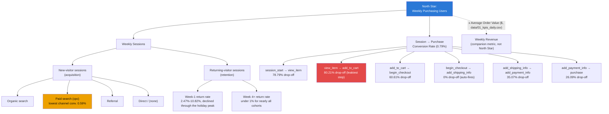

# Metric Tree

North Star: **Weekly Purchasing Users** — the number of distinct users who
complete at least one purchase in a given week. It combines both sides of the
business this data surfaces as weak (first-visit conversion) and weaker
(retention): see `docs/insights.md` findings #1 and #4.

**How to read this:** every leaf metric here is computed in this project —
`SESS`/`NEW`/`RET` split from `data/03_funnel_segments.csv` +
`data/04_cohort_retention.csv`; every `CONV` step from `data/02_funnel.csv`;
`AOV`/`REV` from `data/01_kpis_daily.csv`. The red node (`view_item →
add_to_cart`) is the single highest-leverage input — see `docs/insights.md`
and `docs/experiments.md` for why it's the first thing to fix, and the orange
node (paid search) is the second-highest-leverage input on the acquisition
side.
